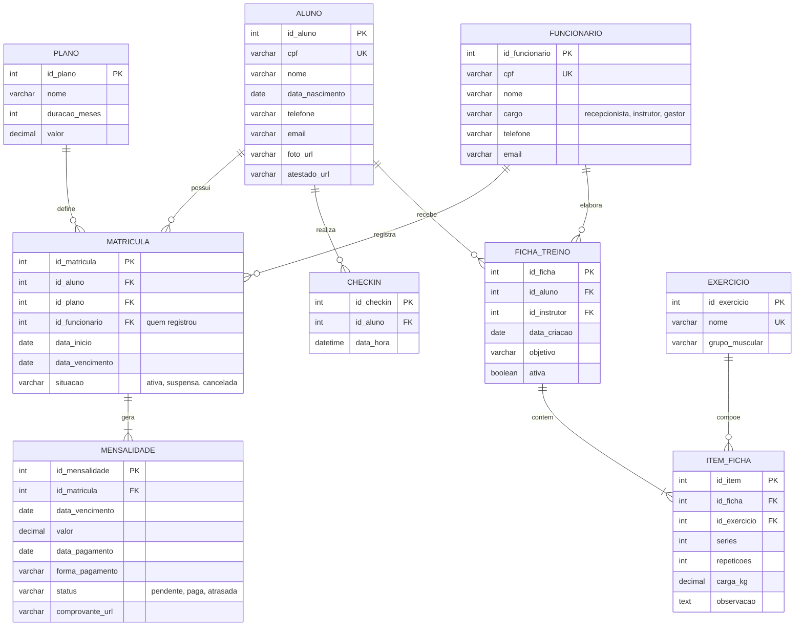

# FitControl: Sistema de Gestão para Academia

Projeto de modelagem de banco de dados relacional para a gestão de uma academia, desenvolvido na disciplina de Modelagem de Banco de Dados do curso de Análise e Desenvolvimento de Sistemas (Cruzeiro do Sul Virtual).

O projeto cobre todo o caminho da concepção do sistema: levantamento do minimundo, definição de escopo, atores e processos, modelagem do Diagrama Entidade-Relacionamento (DER) e normalização até a Terceira Forma Normal (3FN).

## Sumário

- [Visão geral](#visão-geral)
- [Objetivos](#objetivos)
- [Escopo](#escopo)
- [Atores](#atores)
- [Processos principais](#processos-principais)
- [Modelo de dados](#modelo-de-dados)
- [Normalização](#normalização)
- [Suposições de projeto](#suposições-de-projeto)
- [Próximos passos](#próximos-passos)

## Visão geral

O FitControl é um sistema para gerenciar as operações de uma academia, reunindo em um só lugar o cadastro de alunos, planos, matrículas, pagamentos, treinos e frequência. O público-alvo inclui recepcionistas, instrutores e a gestão da academia, além dos próprios alunos, que poderão consultar seus treinos e sua situação financeira. O principal propósito é centralizar as informações para reduzir a inadimplência, acompanhar a frequência dos alunos e apoiar as decisões da gestão com dados confiáveis.

## Objetivos

1. Gerenciar o cadastro de alunos, planos e matrículas, controlando a situação de cada aluno (ativo, inadimplente ou cancelado).
2. Registrar os pagamentos e a frequência dos alunos por meio de check-in, permitindo identificar inadimplência e risco de evasão.
3. Facilitar a criação e o acompanhamento das fichas de treino, vinculando cada aluno ao seu instrutor responsável.

## Escopo

**O sistema vai fazer:**

- Cadastro de alunos, instrutores e funcionários da recepção.
- Cadastro dos planos (mensal, trimestral, semestral e anual) e seus valores.
- Matrículas vinculando aluno e plano, com data de início, vencimento e situação (ativa, suspensa ou cancelada).
- Registro de mensalidades e pagamentos (vencimento, data de pagamento, valor e forma de pagamento), permitindo identificar inadimplentes.
- Controle de frequência por check-in, com data e horário de cada entrada.
- Fichas de treino elaboradas pelos instrutores (exercícios, séries, repetições, carga e observações), mantendo o histórico.

**O sistema não vai fazer (nesta versão):**

- Folha de pagamento e escala de funcionários.
- Controle de estoque e venda de produtos.
- Emissão de notas fiscais.
- Integração com catracas, máquinas de cartão ou plataformas de pagamento.
- Agendamento de aulas coletivas, avaliação física detalhada e acompanhamento nutricional.

## Atores

| Ator | Responsabilidades |
|---|---|
| Recepcionista | Cadastra alunos, realiza matrículas, registra pagamentos e check-ins |
| Instrutor | Cria e atualiza fichas de treino, acompanha a frequência dos seus alunos |
| Gestor | Cadastra planos, valores e funcionários, consulta relatórios gerenciais |
| Aluno | Consulta sua ficha de treino, pagamentos e situação da matrícula (somente leitura) |

## Processos principais

1. **Matrícula:** a recepção coleta os dados do aluno, o sistema valida o CPF (sem duplicidade), o aluno escolhe um plano e o sistema gera a matrícula e as mensalidades com status "pendente".
2. **Pagamento:** a recepção localiza o aluno pelo CPF e registra data, valor e forma de pagamento. Mensalidades vencidas sem pagamento passam para "atrasada" e a matrícula fica "suspensa".
3. **Check-in:** o sistema valida se a matrícula está ativa e sem pendências. Se estiver tudo certo, registra data e hora da entrada; caso contrário, bloqueia o acesso e informa o motivo.

## Modelo de dados

### DER final (normalizado, 3FN)

### Relacionamentos

| Relacionamento | Entidades | Cardinalidade |
|---|---|---|
| Possui | Aluno e Matrícula | 1 : N |
| Define | Plano e Matrícula | 1 : N |
| Registra | Funcionário e Matrícula | 1 : N |
| Gera | Matrícula e Mensalidade | 1 : N (mínimo 1) |
| Realiza | Aluno e Check-in | 1 : N |
| Recebe | Aluno e Ficha de Treino | 1 : N |
| Elabora | Funcionário (instrutor) e Ficha de Treino | 1 : N |
| Contém | Ficha de Treino e Item da Ficha | 1 : N (mínimo 1) |
| Compõe | Exercício e Item da Ficha | 1 : N |

A relação entre **Aluno** e **Plano** é, na prática, muitos-para-muitos (N:M). Ela foi resolvida pela entidade associativa **Matrícula**, que guarda os dados do vínculo (datas e situação) e preserva o histórico de contratações.

Os arquivos dos diagramas estão em [`docs/diagramas`](docs/diagramas):

- [DER inicial](docs/diagramas/der_inicial.png) (antes da normalização)
- [DER final](docs/diagramas/der_final.png) (normalizado)

## Normalização

- **1FN:** o modelo já possuía atributos atômicos e nenhum grupo repetitivo. Os exercícios de uma ficha ficam em linhas separadas, e não em uma lista dentro da ficha.
- **2FN:** todas as entidades usam chave primária simples, então não há dependência parcial.
- **3FN:** no DER inicial, a entidade `EXERCICIO_FICHA` guardava `nome_exercicio` e `grupo_muscular` em cada item da ficha. Como o grupo muscular depende do exercício, e não da ficha, havia uma **dependência transitiva**. A entidade foi decomposta em `EXERCICIO` (catálogo, cadastrado uma única vez) e `ITEM_FICHA` (séries, repetições, carga e observação de cada ficha).

**Redundância intencional:** o valor da mensalidade e a data de vencimento da matrícula são armazenados no momento da contratação, e não buscados do plano. Isso preserva o registro histórico caso o preço ou a duração do plano mudem no futuro.

## Suposições de projeto

- Cada aluno tem apenas uma matrícula ativa e uma ficha de treino ativa por vez; as anteriores ficam como histórico.
- O instrutor responsável por uma ficha é um funcionário com o cargo "instrutor".
- Os pagamentos são apenas registrados, sem integração com bancos ou máquinas de cartão, e cada mensalidade é paga integralmente.
- Fotos, atestados e comprovantes ficam fora do banco; as tabelas guardam apenas o caminho do arquivo.
- O CPF é único, mas não é chave primária: cada tabela usa um identificador numérico gerado automaticamente.

## Próximos passos

- [ ] Scripts SQL de criação das tabelas (DDL) com as restrições do modelo
- [ ] Carga de dados de exemplo
- [ ] Consultas gerenciais: inadimplência, horários de pico, faturamento por plano e risco de evasão

## Autor

**Luiz Covizzi**: [github.com/LufeCovizzi](https://github.com/LufeCovizzi)
